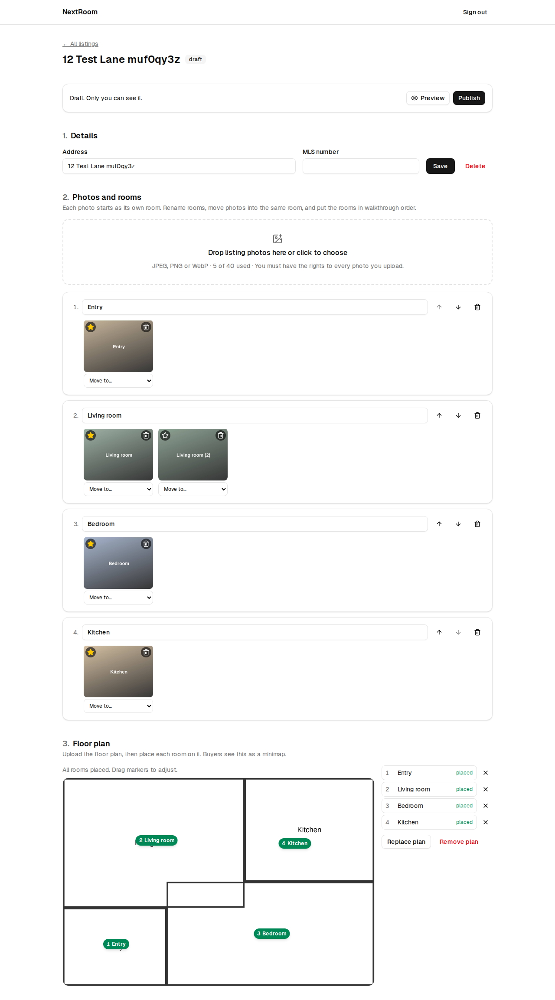
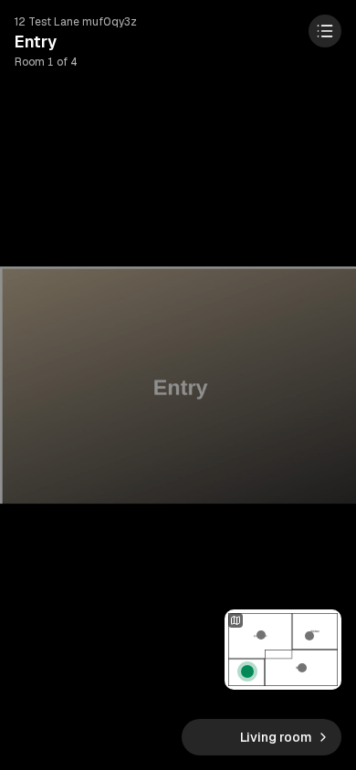
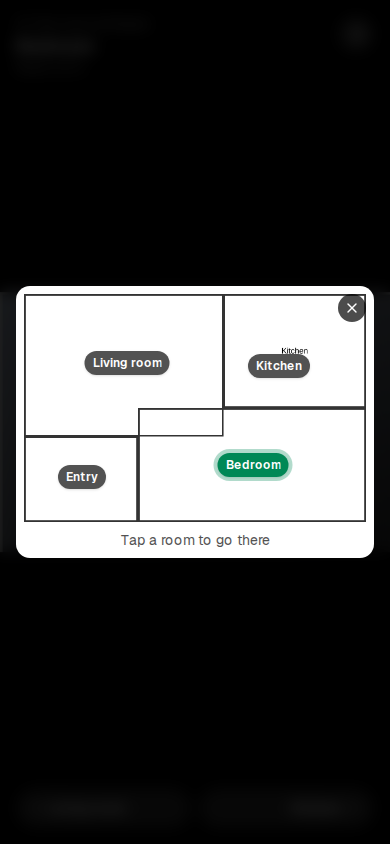

# NextRoom: AI property walkthroughs

Turns a listing's existing photos and floor plan into an interactive walkthrough buyers can move
through, room by room, with a floor-plan minimap showing where they are standing. Sold to agents
per listing. The full product spec is in [`docs/spec.md`](docs/spec.md).

| Agent editor | Buyer view (phone) | Minimap |
|---|---|---|
|  |  |  |

## Status

Phase 1, build steps 1–4 from the spec are done (steps 1–3 are the demo for the first agent):

- [x] **Step 1:** sign up and sign in (email + password), create, edit and delete properties, and
  upload photos straight to Supabase Storage. Photos are resized in the browser to 2560px.
  Uploaders confirm they have the rights to their photos, per spec §4.
- [x] **Step 2:** a public viewer at `/p/<slug>`, built mobile first. The agent names rooms,
  groups photos into rooms, picks each room's primary photo and sets the room order. Buyers tap
  or swipe through photos and rooms, or use the room list. The agent can preview drafts, and
  publishing creates a share link.
- [x] **Step 3:** the agent uploads a floor plan (an image, or a PDF whose first page is used)
  and clicks or drags room nodes onto it. Buyers get a corner minimap that marks the current
  room; tapping it expands the plan, and tapping a room jumps to it.

- [x] **Step 4:** the agent clicks a spot on any photo, such as a doorway, and picks the room it
  leads to. Hotspots can be dragged, re-pointed or deleted. Buyers tap them to walk between rooms.
  Hotspots belong to a photo, not a room (see `supabase/migrations/20260924120000_hotspots_per_photo.sql`),
  so they move with the photo when it is moved into another room.

Next, in spec order:

- [ ] **Step 5:** automatic room labels from a vision model call per photo.
- [ ] **Step 6:** virtual staging with approve and regenerate. The `staged_images` table exists.
  The spec §4 rules are required here: a "virtually staged" label that can't be turned off, and
  no changes to the structure or condition of the room.
- [ ] **Step 7:** embed snippet and lead capture. The `leads` table exists, and anyone can
  already insert a lead on a published property.
- [ ] **Step 8:** Stripe, one-time per-listing pricing.

Known limitations:

- **Draft media is not access-controlled.** The storage bucket is public, so anyone with a draft
  photo's exact URL can open it. The URLs contain random UUIDs, so they can't be guessed. Switch
  to signed URLs if that isn't acceptable.
- **The terms page (`/terms`) is a placeholder.** Have it reviewed before charging agents.
- **Not yet run against a hosted Supabase project.** All testing so far used the local stack.

## Setup

Requirements: Node 20+ and a Supabase project. For local development, Docker plus the Supabase
CLI works instead of a hosted project.

### 1. Supabase

**Hosted project:**

1. Apply the schema, using either option:
   - In the Supabase dashboard, open **SQL Editor**, paste in
     each file in `supabase/migrations`, in filename order, and run it.
   - Or run `npx supabase link --project-ref <ref>` and then `npx supabase db push`.
2. Under **Authentication → URL Configuration**:
   - Set **Site URL** to your app's URL.
   - Add `<your app URL>/auth/confirm` to **Redirect URLs**.
3. Email confirmation is on by default. New agents get a link that returns them to
   `/auth/confirm`.

**Local stack:** run `npx supabase start`. The migrations in `supabase/migrations` are applied
automatically on first start. To reapply them, run `npx supabase db reset`.

### 2. Environment

Copy `.env.example` to `.env.local` and fill in the values from **Project Settings → API**:

```
NEXT_PUBLIC_SUPABASE_URL=...
NEXT_PUBLIC_SUPABASE_ANON_KEY=...   # the "anon" or "publishable" key
NEXT_PUBLIC_SITE_URL=...            # optional; used for share links
```

The service-role key is not needed. The app talks to Supabase only with the anon key plus the
signed-in user's session, and row-level security controls what each user can read and write.

### 3. Run

```bash
npm install
npm run dev          # http://localhost:3000
```

## Checks

```bash
npm run typecheck
npm run lint
npm run build
npm run test:e2e     # needs a running local Supabase stack and a prior `npm run build`
```

The end-to-end test in `tests/e2e/walkthrough.spec.ts` runs the whole flow:

1. Sign up and create a listing.
2. Upload 5 photos, then rename, merge and reorder the rooms.
3. Upload a PDF floor plan, place every room, and drag a marker (the new spot must survive a
   reload).
4. Add, re-point and delete hotspots on two photos (they must survive a reload).
5. Publish.
6. As a buyer on a phone-sized screen: tap a hotspot, move through the photos and rooms, then use
   the minimap and the room list.
7. Check privacy: logged-out visitors can't open the draft preview, unpublishing makes the public
   page return 404, and a second agent can't see or open the first agent's listing.

The test fixtures are generated by `node tests/make-fixtures.mjs`.

## Project layout

```
src/app/(auth)/                 sign-in and sign-up pages and their server actions
src/app/dashboard/              agent listings, the property editor and preview
src/app/dashboard/actions.ts    all write operations (server actions)
src/app/p/[slug]/               public walkthrough page
src/components/walkthrough.tsx  the buyer-facing viewer, with its hotspots, minimap and room list
src/components/ui/              shadcn/ui components
src/lib/                        Supabase clients, upload helpers, shared types
src/proxy.ts                    refreshes the session; guards /dashboard
supabase/migrations/            schema, row-level security, storage bucket and policies
```
