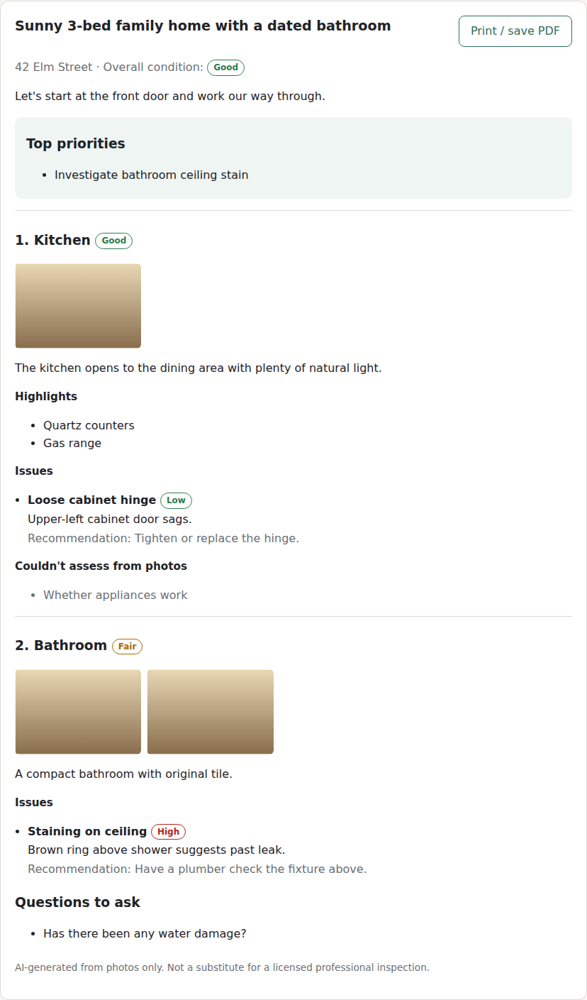

# AI Property Walkthrough

Upload photos of a property room by room. The app returns a guided walkthrough with a condition
report written by Claude:

- narration for each room, in the order you list the rooms
- highlights, plus a condition rating for each room and for the property overall
- visible issues, each with a severity (low / medium / high) and a recommendation
- what couldn't be judged from the photos, so the report doesn't guess
- top priorities and questions to ask the seller, agent or landlord
- a print-friendly layout, so you can save the report as a PDF



## Running it

Requires Node 20+ and an [Anthropic API key](https://console.anthropic.com/).

```bash
npm install
export ANTHROPIC_API_KEY=sk-ant-...
npm start            # http://localhost:3000
```

Optional environment variables:

| Variable | Default | Purpose |
|---|---|---|
| `PORT` | `3000` | HTTP port |
| `WALKTHROUGH_MODEL` | `claude-opus-5` | Claude model used for the analysis |

## How it works

- `public/`: a dependency-free web page. Photos are resized in the browser (longest edge
  1568px, JPEG) before upload so requests stay small.
- `server.js`: a small Node HTTP server. It serves the page and exposes `POST /api/walkthrough`.
- `src/walkthrough.js`: validates the request and sends one Claude request with every room's
  photos, labeled in order. It uses structured outputs (a JSON schema) so the report always has
  the same shape. It also uses adaptive thinking and streaming, and turns on server-side refusal
  fallbacks (`fallbacks: "default"`).

Limits: 30 rooms, 6 photos per room, 60 photos in total.

## Tests

```bash
npm test
```

The tests use a stubbed Claude client, so they need no API key and make no network calls.

> The reports are generated by AI from photos only. They are not a substitute for a licensed
> professional inspection.
